# 《易林补遗》各分类占断技法与白话精粹

> **著作者**：〔明〕张世宝（字星元，明代盲人易学大师） 著  
> **整理底本**：明万历三十二年甲辰（1604年）原刊本（国家图书馆藏本对校 · 西川斋整理本）  
> **整理宗旨**：全面提炼原书一百四十五章实战技法，保留全部纳甲六爻专业术语，以精确平实的现代白话文进行系统译注与归纳。

---

## 目录导引

- [第一篇：张星元易学底层逻辑与占断总诀（易林总断章第一）](#第一篇张星元易学底层逻辑与占断总诀)
  - [一、 主用与动变：动静分推心法](#一-主用与动变动静分推心法)
  - [二、 飞伏阴阳互换与“出暴”妙诀](#二-飞伏阴阳互换与出暴妙诀)
  - [三、 动爻老阴老阳必变论（辨正京房之讹）](#三-动爻老阴老阳必变论辨正京房之讹)
  - [四、 长生十二宫与生克冲合活变](#四-长生十二宫与生克冲合活变)
  - [五、 六神与岁时神煞取象法则](#五-六神与岁时神煞取象法则)
- [第二篇：十四大类实战分类技法详析与白话译注](#第二篇十四大类实战分类技法详析与白话译注)
  - [一、 天时晴雨与地理风水类（第2、3章）](#一-天时晴雨与地理风水类)
  - [二、 朝廷国事与出师兵戎类（第4、5章）](#二-朝廷国事与出师兵戎类)
  - [三、 时岁丰歉与身命寿夭类（第6、7、8章）](#三-时岁丰歉与身命寿夭类)
  - [四、 媒妁结缡与婚姻嫁娶类（第9至12章）](#四-媒妁结缡与婚姻嫁娶类)
  - [五、 子嗣传承与胎产育幼类（第13至21章）](#五-子嗣传承与胎产育幼类)
  - [六、 训蒙学艺与师资进德类（第22至27章）](#六-训蒙学艺与师资进德类)
  - [七、 科举应试与仕宦升迁类（第28至37章）](#七-科举应试与仕宦升迁类)
  - [八、 居舍营造、置产与阳宅风水类（第44至53章、第117章）](#八-居舍营造置产与阳宅风水类)
  - [九、 求财经商、买卖借贷与产业民生类（第104至115章、第54至55章）](#九-求财经商买卖借贷与产业民生类)
  - [十、 陆水出行、舟车关隘与行人音信类（第88至100章）](#十-陆水出行舟车关隘与行人音信类)
  - [十一、 人际交往、托庇防患与忧疑解厄类（第38至43章、第61至75章、第81至87章、第101至103章）](#十一-人际交往托庇防患与忧疑解厄类)
  - [十二、 词讼举告、刑狱禁系与和息免罪类（第120至133章）](#十二-词讼举告刑狱禁系与和息免罪类)
  - [十三、 盗贼捕捉、失物走失与避难藏匿类（第64章、第134至139章）](#十三-盗贼捕捉失物走失与避难藏匿类)
  - [十四、 农桑稼穑、六畜养殖、竞技博弈与释道修真类（第56至60章、第112至113章、第140至145章）](#十四-农桑稼穑六畜养殖竞技博弈与释道修真类)
- [第三篇：张星元“盲师实战心法”三大绝学归纳](#第三篇张星元盲师实战心法三大绝学归纳)

---

# 第一篇：张星元易学底层逻辑与占断总诀

《易林补遗》卷之一首列《易林总断章第一》，是明代盲师张世宝平生占卜精髓的“总纲领”，奠定了全书一百四十五章分类占断的数理基石。

### 一、 主用与动变：动静分推心法
* **原文旨要**：「凡事取用爻为主，动变为凭。吉凶二字系乎卦爻动静，静则取暗动并用爻为主，动则取之卦为凭。」
* **白话精准译注**：
  占断任何事情，首先必须在六爻中确立核心的**用爻（用神）**，作为所占事物本质与主体的寄托；而事情发展变化的吉凶成败，则全看**动爻**与**变卦（之卦）**。
  - **若全卦安静（六爻皆静）**：此时卦无明动，应取被日辰冲动而旺相的**暗动之爻**以及**静用爻**作为主导来推断吉凶；
  - **若卦中有动爻（一爻动或多爻动）**：动则必变，动爻是事物发生转化的枢纽，必须以动爻化出的**之卦（变卦）**纳甲、六亲变动及变爻对动爻的回头生克为凭据。变者，是事物发生造化的端倪；化者，是最终形成的结果。

### 二、 飞伏阴阳互换与“出暴”妙诀
* **原文旨要**：「飞伏在二仪交换定然，阳伏阴而阴伏阳。八纯飞伏如此定之……爻爻有伏有飞，伏无不用。飞为已往，伏为将来。若卦内有用神不居空陷，不必更取伏神；如六爻不见主象者，却取伏神推之。」
* **白话精准译注**：
  - **飞伏体系的阴阳对立互换**：八纯卦各取对待之卦为伏象（乾伏坤、坤伏乾、坎伏离、离伏坎、震伏巽、巽伏震、艮伏兑、兑伏艮）；各宫次卦至归魂卦，则依本宫纯卦或归魂游魂之例推排。飞爻为显露在外的表象、代表已经发生的事；伏神为潜藏在内的隐机、代表未来的生机。
  - **取伏原则**：若本卦六爻中用爻明现且不值旬空、月破、衰陷，则直接以飞爻断之，不必强取伏神；只有当本卦六爻全无用爻主象时，才须深挖伏神。
  - **张星元特异飞伏四象**：
    1. **飞来生伏得长生**：飞神生伏神（如父占子病，得乾卦子孙伏坤亥水，伏在飞神壬申金之下，申金生亥水），虽用神伏藏且旬空，但得飞神贴身相生，称为“飞来生伏得长生”，反凶为吉，逢用神当权之日病必愈；
    2. **伏克飞神为“出暴”**：伏神克飞神（如求财得噬嗑卦，财爻伏藏，但伏财克飞爻水），若用神旺相，伏神克破飞神强行出头，称为“出暴”，主横发资财或异军突起；
    3. **飞能克伏必遭殃**：飞神克制伏神（如财爻伏在官鬼之下，水克火），飞神在上如泰山压顶，用神受克无出头之日，求财必空，求名必阻；
    4. **空破透伏**：飞神虽克伏神，但若飞神逢旬空或月破，飞神无力克制，伏神便能趁空脱颖而出，称为“空破透伏”。

### 三、 动爻老阴老阳必变论（辨正京房之讹）
* **原文旨要**：「动者，老阴老阳无不变化，凡阳极而生阴，阴极即生阳，故此交变单，而重变拆也。宗庙爻既不变化，焉能纯乾变为纯坤？经中自有用九见群龙无首吉爻辞可证，故此爻爻皆变也。」
* **白话精准译注**：
  后世相传汉代京房纳甲有“第六爻为宗庙宗庙不动”、“乱动则不变”的说法，张星元在此进行了坚决的理论辨正：
  易道崇尚天地阴阳大化，只要爻值“重”（老阳）或“交”（老阴），皆是物极必反的变爻，绝不存在乱动不变或上爻宗庙不动的道理。变出他宫之卦，一律取变出之支五行，回归本卦重新排定生克六亲（变出之爻以本卦六亲为准审其生克）。

### 四、 长生十二宫与生克冲合活变
* **原文旨要**：「长生、沐浴、冠带、临官、帝旺、衰、病、死、墓、绝、胎、养，周而复始。贪生忘克，合处逢冲，冲中逢合。」
* **白话精准译注**：
  - **生旺墓绝实战定论**：长生主发生、萌芽与起步；帝旺主极盛与巅峰；墓库主隐藏、阻滞、收敛与昏迷；绝地主体气衰竭、断绝无助；胎养主孕育待机。
  - **贪生忘克法则**：忌神发动欲克用神，若卦中有爻能泄忌神之气而转生用神（如木鬼动克土身，卦中火动，木贪生火，火转生土），则忌神贪生忘克，凶象化解为吉庆。
  - **冲合转折法则**：卦逢合本主成就稳固，但若逢动爻冲破或日辰冲破，为“合处逢冲”，主先好后坏、中途退悔；卦逢相冲本主散离凶危，但若变爻相合或得日辰会合，为“冲中逢合”，主先险后安、破镜重圆。

### 五、 六神与岁时神煞取象法则
* **六神司职**：
  - **青龙**：吉神，主喜庆、婚姻、子嗣、胎产、高贵、花酒、官禄。
  - **朱雀**：文书、信息、口舌、是非、飞语、词状、官司之神。
  - **勾陈**：田土、房产、淹滞、留连、勾连、牵缠、迟缓。
  - **螣蛇**：虚惊、怪异、噩梦、惊恐、疑虑、暗昧、变幻莫测。
  - **白虎**：凶丧、血光、暴疾、孝服、刑戳、强梁、产难之煞。
  - **玄武**：阴私、暧昧、盗贼、失脱、隐情、走失、奸诈之神。
* **神煞纲领**：天乙贵人解难，天月二德扶危，驿马主流动迁变，咸池主淫佚花柳，丧门吊客兼白虎见生必哭泣，官符死符遇朱雀必招刑狱。

---

## 第二篇：十四大类实战分类技法详析与白话译注

《易林补遗》核心占验体系由一百四十五章构成，其独创特征是**“双轨定象”——每章必先明确“以何为主爻（用爻），以何为凭藉（参佐）”**，使占者落卦便能立定标的，不致杂乱无章。以下按实用领域分门汇编精析：

```mermaid
flowchart TD
    A["《易林补遗》实战占断体系 (145章)"] --> B["自然时序与地理"]
    A --> C["身命家宅与人伦"]
    A --> D["仕进功名与资财"]
    A --> E["行藏刑讼与疾崇"]
    A --> F["农蚕博弈与百相"]

    B --> B1["天时晴雨 (第2章)"]
    B --> B2["地理风水 (第3章)"]
    B --> B3["国运年时 (第4-6章)"]

    C --> C1["身命寿夭 (第7-8章)"]
    C --> C2["婚姻媒妁 (第9-12章)"]
    C --> C3["子嗣胎产 (第13-21章)"]
    C --> C4["家宅营造 (第44-53章)"]

    D --> D1["师资训蒙 (第22-27章)"]
    D --> D2["科举仕宦 (第28-37章)"]
    D --> D3["求财经商 (第104-115章)"]

    E --> E1["舟车出行 (第88-100章)"]
    E --> E2["词讼牢狱 (第120-133章)"]
    E --> E3["逃亡盗贼 (第134-139章)"]
    E --> E4["疾病医药鬼神 (第89-104章)"]

    F --> F1["农林六畜 (第56-60章)"]
    F --> F2["博弈游艺 (第112-113章)"]
    F --> F3["玄学修真 (第140-145章)"]
```

---

### 一、 天时晴雨与地理风水类
* **涵盖章节**：天时晴雨章第二、地理风水章第三。
* **核心技法与用爻法则**：
  - **天时占**：`占雨取父母为主，水象为凭；占晴取子孙为主，火象为凭。`
    * **白话精解**：测雨看父母爻与水爻，父母动或水旺动主大雨滂沱；测晴看子孙爻与火爻，子孙动或火爻旺相主旭日当空。子孙持身世不动亦主晴天；父爻静而逢日辰冲动（暗动），天色骤变。若久雨求晴，须得妻财爻当道或子孙值日克制父水，方能放晴。
  - **风水占**：`未葬取父母为主，宜旺相以生身；已葬取官鬼为凭，怕交重而克世。`
    * **白话精解**：选地未下葬时，父母爻代表地脉、穴场、棺椁与地气，必须旺相且生助世爻，才是福泽后人之吉壤；若已经安葬之后问家运风水，则以官鬼爻代表亡魂、祖茔气场与祸福枢纽，官鬼若发动克世爻，主后人有官非灾病。选地最忌六冲卦，六冲主“水走沙飞，生气不聚”，子孙爻落空破绝地，后代人丁萧条，绝不可安茔。

---

### 二、 朝廷国事与出师兵戎类
* **涵盖章节**：朝廷国事章第四、出师征伐章第五。
* **核心技法与用爻法则**：
  - **国事占**：`以世爻为主，应象为佐，六合子旺为吉，六冲杀动为凶。`
    * **白话精解**：世爻代表国家本体与朝廷执政者，五爻代表天子君位，应爻代表四方万民或外部藩邦。得六合卦且子孙爻旺相，象征君明臣贤、天下太平、五谷丰登；若遇六冲卦、白虎官鬼发动克世，主政令纷乱或兵戈窃发。
  - **出师战阵占**：`以世应为主，福德为凭。`
    * **白话精解**：世爻为我方将士三军，应爻为敌国敌军阵线；子孙爻为机谋策略、先锋粮饷与护军神明。世克应、世旺应衰、子孙持世克敌鬼，我军必操胜券；世应相合，两军议和不战；应爻动克世爻、或父母白虎发动伤克子孙，我军恐中伏损兵。

---

### 三、 时岁丰歉与身命寿夭类
* **涵盖章节**：年时丰歉章第六、身命造化章第七、六亲寿命章第八。
* **核心技法与用爻法则**：
  - **年景年成**：`以身世为主才，福为凭。`
    * **白话精解**：身世逢妻财、子孙旺相，或子财临太岁持世，主五谷大熟、丰年乐业；兄弟、官鬼交重发动克财克世，主旱涝虫霜、饥荒欠收。水火安静风调雨顺，水多旱涝，火炎大旱。
  - **自身命格**：`占自己以世爻为主，占他人以用象为凭。卜平生之得失，世莫休囚；占一世之荣枯，身宜旺相。`
    * **白话精解**：本卦代表少壮根基，变卦代表晚年结局。世爻与身爻逢旺相、得青龙日月贵人相生相扶，平生通达显贵；若世爻陷于墓绝空破、被白虎官鬼刑伤，一世坎坷多灾。
  - **六亲寿算**：`以用爻为主，父母为凭（椿萱看父母，手足取弟兄，室家凭财位，夫子向官寻）。`
    * **白话精解**：看特定亲人之寿算，各取其六亲用爻为核心。用爻旺相安静且得生扶，必享遐龄长寿；若用爻衰弱发动，又变出回头克、变出墓绝死败，大限将至。

---

### 四、 媒妁结缡与婚姻嫁娶类
* **涵盖章节**：倩媒说合章第九、婚姻嫁娶章第十、女卜男婚章第十一、女家择婿章第十二。
* **核心技法与用爻法则**：
  - **媒妁中人**：`占婚以间爻为主，问媒以应象为凭。`
    * **白话精解**：世应之间的间爻为媒人，应爻亦代表做媒之人。应爻生合世爻，媒人热心尽责且心向我方；应爻刑克世爻或临朱雀玄武，媒人虚伪狡黠、言不由衷。间爻落空，媒人无功或中途退缩。
  - **嫁娶大旨**：`以内外世应为主，阴阳才鬼为凭。`
    * **白话精解**：男占妻看财爻与内卦，女占夫看官爻与外卦。卦忌纯阳（男占鳏独，必损原配）与纯阴（女占寡居，夫纲不振）。男占喜世阳应阴、世得内卦应得外卦（乾坤定位）；女占喜世阴应阳、外阳内阴。财官两全、世应相生合，百年好合；世应相冲克或化回头冲，临门毁约或婚后反目。

---

### 五、 子嗣传承与胎产育幼类
* **涵盖章节**：后嗣有无章第十三、怀胎虚实章第十四、安护胎息章第十五、收生保产章第十六、六甲生产章第十七、选择乳母章第十八、婴童否泰章第十九、出继男女章第二十、承继续嗣章第二十一。
* **核心技法与用爻法则**：
  - **求子嗣**：`以子孙为主，不遇绝空克破为佳。`
    * **白话精解**：卦中子孙爻不论旺衰，只要不上卦不落空亡，便断定后继有人。若本卦无子孙，察看伏象；伏象有子孙且不空，主得子较晚；若本卦伏神皆无子孙，看动爻变出子孙，变出有子为招养或晚得之子。
  - **孕产胎神**：
    * **怀胎虚实**：子孙胎爻（长生十二宫之“胎”爻）为主，青龙天喜为佐。子孙上卦不空、临胎爻受生，确为真孕；若子孙空亡又临白虎朱雀动，多为虚喜或胎气郁结。
    * **安胎与生产**：安胎喜子孙静旺、忌官鬼发动（鬼动惊胎）；若求临盆分娩，反喜官鬼、兄弟发动冲击子孙，为“瓜熟蒂落”。子临阳爻动生男，临阴爻动生女。

---

### 六、 训蒙学艺与师资进德类
* **涵盖章节**：更名顶籍章第二十二、平生学艺章第二十三、五经定肄章第二十四、求师训迪章第二十五、求馆开设章第二十六、相资寓所章第二十七。
* **核心技法与用爻法则**：
  - **拜师择塾**：`求师训迪以文书为主，八卦为凭；求馆开设以世应为主才，福为凭。`
    * **白话精解**：学生求名师，以父母（文书）爻为老师，应爻为塾师之身。父母旺相得地、临青龙贵人，乃德才兼备之明师；应爻克世或父母落空，名实不副或缘分浅薄。塾师外出坐馆开馆，以世为自身，应为东家东席，妻财为束脩酬金，子孙为蒙童门生。应生世、财旺相，主东宾和洽、束脩优厚。

---

### 七、 科举应试与仕宦升迁类
* **涵盖章节**：应举科名章第二十八、仕宦升迁章第二十九、袭求武弁章第三十、援监纳吏章第三十一、选缺参房章第三十二、官员荐奖章第三十三、上书启奏章第三十四、朝天面圣章第三十五、恩封诰命章第三十六、文书消息章第三十七。
* **核心技法与用爻法则**：
  - **科名及第**：`以文书（父母）为主，官鬼为凭。`
    * **白话精解**：科举大忌子孙爻发动，子孙为“剥官制煞”之神，子孙动则功名无份。最喜官鬼爻与父母爻旺相相生，官星持世、父母发动化出官星，定然金榜题名、独占鳌头。兄弟爻旺动，同侪竞争激烈，文卷恐遭挤压。
  - **仕官转迁**：`以官爻为主，世象为凭。`
    * **白话精解**：官员问升迁除授，官鬼代表官衔、官职，父母代表印信与朝廷批文敕命。官星生世、合世，迁升美缺；官星克世、冲世，防降职贬谪；官星入墓或化绝，削职罢官之兆；官伏空亡，选缺淹滞。

---

### 八、 居舍营造、置产与阳宅风水类
* **涵盖章节**：人宅六事章第四十四、创造宫室章第四十五、修方动土章第四十六、工匠巧拙章第四十七、涓选日时章第四十八、迁移居住章第四十九、同居共寓章第五十、置产立户章第五十一、寄装丁产章第五十二、治家分合章第五十三、卧床趋避章第一百十七。
* **核心技法与用爻法则**：
  - **人宅六事与起造**：`人宅六事以动爻为主，内外为凭；创造宫室以子孙为主，身世为凭。`
    * **白话精解**：内卦为宅，外卦为人。初爻为地基井泉，二爻为灶堂灶舍，三爻为门廊中堂，四爻为外门道路，五爻为人丁宅主，六爻为栋梁宗庙。动爻临白虎克初爻，地基有凶；克二爻，灶位不安；克五爻，宅长有疾。盖房动土最喜子孙生旺、身世安泰，子旺能镇压诸般土煞官鬼。
  - **移居租寓**：`以世应为主，内外衰旺为凭。`
    * **白话精解**：内卦为旧居，外卦为新迁之处。内克外、外卦生合世爻，迁居大吉；外卦克世、临玄武官鬼，新居风水不顺、盗耗侵凌。

---

### 九、 求财经商、买卖借贷与产业民生类
* **涵盖章节**：求财觅利章第一百四、开张店肆章第一百五、收顿货物章第一百六、托本求利章第一百七、索取债利章第一百八、借贷财物章第一百九、摇会得失章第一百十、变产求财章第一百十一、添丁纳使章第五十四、雇倩人工章第五十五。
* **核心技法与用爻法则**：
  - **求财商贾通则**：`将本求利以才爻为主，福德为凭。`
    * **白话精解**：妻财爻为利润与资本，子孙爻为财源与利息生发之根，兄弟爻为劫财折本之阻隔，官鬼爻为耗损克扣与盗贼。
    * **财福两旺**：本小利大，日进斗金；
    * **才爻发动化兄弟**：买卖中途蚀本，反遭他人分夺；
    * **兄弟持世动**：切不可投资开店，定主破耗倾囊；
    * **索取逋欠**：应爻为债务人，财爻为原欠资财。应爻生世克世爻，还款有望；应爻临空化破，债家逃匿无着。

---

### 十、 陆水出行、舟车关隘与行人音信类
* **涵盖章节**：登舟渉水章第八十八、风行顺逆章第八十九、乘车驾马章第九十、水陆出行章第九十一、同行共处章第九十二、关隘津渡章第九十三、旅望行人章第九十四、行人逺囘章第九十五、音书远信章第九十六、觅人访友章第九十七。
* **核心技法与用爻法则**：
  - **出行吉凶**：`占自己以世爻为主，占他人以用象为凭；登舟以父爻为主，世应为凭。`
    * **白话精解**：出行以世爻代表自身安危，应爻代表目的地环境，父母爻代表车马船舶行李。世爻旺相、得子孙伴随，水陆平顺无虞；世爻若遭白虎官鬼动克，半途必遭风浪匪盗或突发重病。涉水大忌水爻交重冲克世爻，水旺动克身，须防倾覆之灾。
  - **望行人归期**：`以用爻为主，月卦为凭。`
    * **白话精解**：测行人以六亲用神为主（占子看子孙，占友看应爻）。用神动生世爻、飞跃上卦，行人已整装起行或归心似箭；用神临世爻化进神，行人在路途一日千里；用爻静伏逢空、入墓受克，被他事所羁留，短日难见归影。

---

### 十一、 人际交往、托庇防患与忧疑解厄类
* **涵盖章节**：趋谒贵人章第三十八、谋望成事章第三十九、忧疑损害章第六十一、防非避讼章第六十二、防火避熖章第六十三、隄防盗贼章第六十四、避暑灾瘴章第七十一、察人喜怒章第八十一、探人虚实章第八十二、用人臧否章第八十三、仗托人力章第八十四、交朋结友章第一百一、紏合伙件章第一百二。
* **核心技法与用爻法则**：
  - **见贵谒见**：`以世应为主，外卦月卦为凭。`
    * **白话精解**：世为求见之人，应为所见贵官大尹。应爻得地生合世爻，贵人欢喜接纳、大力扶持；应爻受克休囚或落空亡，贵人公冗不见，或相见傲慢冷淡。
  - **防非避灾**：`以身世为主，福德为凭。`
    * **白话精解**：心怀忧疑、恐惧意外损害时，只要子孙爻旺相持世或发动于卦中，福神临门，诸般凶煞自然消解（子能制鬼解百灾）；若官鬼持世动带白虎螣蛇，灾患如影随形，必须退藏避祸。

---

### 十二、 词讼举告、刑狱禁系与和息免罪类
* **涵盖章节**：斗殴争竞章第一百二十、兴词举讼章第一百二十一、讼师美恶章第一百二十二、保人强弱章第一百二十三、公私见证章第一百二十四、官司胜负章第一百二十五、忧监虑禁章第一百二十六、离枷出狱章第一百二十七、回关塌讼章第一百二十九、公私和息章第一百三十、申详允驳章第一百三十一。
* **核心技法与用爻法则**：
  - **打官司胜负**：`以官鬼为主，世应为凭。`
    * **白话精解**：世爻为我方起诉人/原告，应爻为被告彼方，官鬼爻为正堂主审法官，父母爻为主裁判词案卷，朱雀为状纸言词。
    * **官星生世克应**：法官公允袒护我方，我胜彼败；
    * **官星生应克世**：法官受彼蒙蔽或受贿，我方败诉招罪；
    * **子孙旺动**：此讼不日公私和解，烟消云散；
    * **入狱遇子孙动生世**：天降恩赦，离枷出狱之期已定。

---

### 十三、 盗贼捕捉、失物走失与避难藏匿类
* **涵盖章节**：遗迷失物章第一百三十五、捕捉逃亡章第一百三十六、潜身避难章第一百三十七、鬻身投主章第一百三十八、投充兵卒章第一百三十九。
* **核心技法与用爻法则**：
  - **失物寻找**：`以妻财为主，福德为凭。`
    * **白话精解**：财爻代表丢失之钱财物件。
    * **财在内卦安静**：物件未离家宅，多遗忘在室内橱柜私处；
    * **财在外卦发动**：物已流失出外，难于追寻；
    * **财爻化鬼或临玄武**：确被贼盗窃走；
    * **财爻伏在子孙下**：物在晚辈小儿处，并未失落，探访自现。
  - **捕盗搜赃**：官鬼代表贼犯，玄武代表行窃手段，子孙为巡捕缉盗之公差。子孙旺动克制官鬼，贼人插翅难逃，必定捕获解官。

---

### 十四、 农桑稼穑、六畜养殖、竞技博弈与释道修真类
* **涵盖章节**：布种田禾章第五十六、养蚕作茧章第五十八、桑叶贵贱章第五十九、六畜禽兽章第六十、慱戯求财章第一百十二、捕猎畋渔章第一百十三、出家修行章第一百四十、修真炼性章第一百四十一、坐关不语章第一百四十二、持斋受戒章第一百四十三、开斋破戒章第一百四十四、归宗还俗章第一百四十五。
* **核心技法与用爻法则**：
  - **六畜养殖**：`以子孙为主，分宫生肖为凭。`
    * **白话精解**：子孙统领一切禽畜生息。按地支取象：子为燕蝠，丑为牛犊，寅为虎豹猫犬，卯为兔狐，辰为龙蛇鱼鳖，巳为长虫，午为马匹骡驴，未为羊羔，申为猿猴，酉为鸡禽，戌为猎犬，亥为猪豚。子孙旺相无克，六畜蕃息；白虎官鬼动克，六畜瘟疫死伤。
  - **释道出家修真**：`修释（佛家禅门）以金为主，修道（玄门道术）以木为凭。`
    * **白话精解**：入佛参禅以金爻清虚为正果，入道修仙以木爻生发为法嗣。身世若入空亡、临玄武青龙，超然物外、能悟真谛；若世临妻财官鬼交重，尘缘难断，终归还俗归宗。

---

## 第三篇：张星元“盲师实战心法”三大绝学归纳

张世宝因幼年失明，目不视物而内照晶莹，其占断完全摆脱了后世死板填词的教条，形成了其震动明代士大夫阶层的**三大绝学**：

### 绝学一：“双轨定象法”（以……为主，以……为凭）
后世六爻常陷入“单一用神”的死胡同（如只看妻财或只看官鬼）。张星元每章必设立**两个坐标轴**：
1. **主轴（体）**：用爻（主象）——判定事物本体的存在、本质属性与主体气数；
2. **凭轴（用）**：佐象（凭藉）——判定事物的外部环境、交涉对象、动力源泉与变数所在。
例如：
- 占媒人：“间爻为主（媒之体），应象为凭（媒之情）”；
- 占建房：“子孙为主（安泰压煞之福），身世为凭（居者受纳之量）”；
- 占风水：“未葬看父（地之气脉），已葬看鬼（魂之安危）”。
双轨并审，卦意昭然若揭。

### 绝学二：“飞伏活盘与出暴论”
通常占卜见用神不现便断为“无望”或“不成”。张星元精研汉焦延寿、京房飞伏互换真机，指出：
- **伏不是死绝，而是潜伏待机**：
  若得“飞来生伏”，伏神在地下反而获得长生源泉；
  若伏神旺盛反克飞神，称为“出暴”，如同巨龙破冰、幼芽破土，常在困境中绝处逢生，爆发奇功；
  若飞神落空、破、死、绝，伏神自能借隙透出。这正是盲师断卦每每令士大夫拍案叫绝的独门关窍。

### 绝学三：“事分一百四十五门之极微”
《易林补遗》之所以设 145 章，正是盲师在苕溪卖卜二十年、面对三教九流民间实际疾苦所淬炼出的“经验数据库”。
它绝不把“求财”混为一谈，而是严格区分：
- 是开店？是放债？是索债？是投行？是变卖产业？是收顿存货？是托人带本？
甚至将“官司”细分为：
- 兴讼、聘请讼师、寻觅保人、证人证词、坐牢系狱、离枷出狱、巡按提卷、官私和解、上宪批驳。
这种将占断情境推演至微毫的实战心法，正是今日六爻学人破除含糊笼统、实现精准决断的至宝法门。
